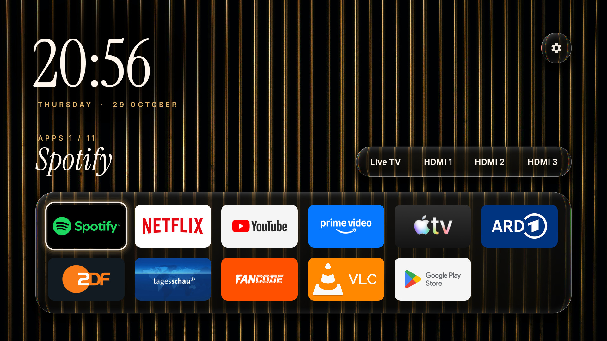

# Rattan

A small, quiet home screen for Android TV. It is built for one TV, a TCL 65P7K with Google TV 12.



- A still photo as the background with smoked glass for the inputs, the settings button and the
  app dock. One OpenGL shader draws photo and glass: the rim bends the photo, the inside is darkened
  and lightly frosted, the edge catches the light, and a soft oval quiets the photo behind the
  clock. It redraws only when the layout changes, never on focus.
- Type: a large Instrument Serif clock with a letter-spaced gold date, and the focused item's name
  in italic serif above the dock.
- Focus is one glass lens that springs from item to item, reshaping as it goes: a ring with a
  gold glow around app banners, a clear pane over controls. It glides within the dock or the
  inputs and reappears when moving between them. Nothing pulses.
- Every app fits in the dock (balanced rows of at most seven); focus always starts on the first app.
- Live TV opens the FRITZ!Box's cable channel list (`http://192.168.178.1/dvb/m3u/tvhd.m3u`) in VLC.
- Remote buttons (an accessibility service that sees key presses only): Netflix and YouTube open
  their apps, TV opens Live TV, and the clean-up button goes home and closes background apps. Apps
  that are playing (Spotify with music on) keep running. The codes are TCL's (`RemoteKeys.kt`).
- No network access of its own: the app has no `INTERNET` permission.

## Results on the TV

Measured on the TCL 65P7K (1.8 GB RAM) on 2026-10-29, before the clean-up with the Google TV home
screen and after it with Rattan, both after a reboot:

| | Before | After |
| --- | --- | --- |
| Free memory | 398 MB | 809 MB |
| Free swap (of 650 MB) | 163 MB | 404 MB |
| Home screen memory | 97 MB (Google TV) | 25 MB (Rattan) |
| Back to Home from Netflix | — | 0.22 s |
| Cold start | — | 0.5–0.6 s |

The glass redraws only when the layout changes (none over 20 fast focus moves); the focus lens is
drawn by the views, which keeps it in step with the remote.

## Build

Requirements: JDK 17 and the Android SDK (platform 36, build-tools 36).

```sh
export JAVA_HOME=/opt/homebrew/opt/openjdk@17/libexec/openjdk.jdk/Contents/Home
./gradlew assembleRelease
```

Release builds are signed with `signing/release.jks`, as configured in `signing/keystore.properties`.
Both files stay out of git; without them the release APK is unsigned.

`tools/make_wallpaper.py <photo>` turns a photo into the background (1920x1080, the TV's UI size),
its frosted copy, the banner and the icon.

## Install

```sh
tools/install.sh            # TV at 192.168.178.59:5555, or pass ip:port
```

It builds, installs, compiles ahead of time, grants TCL's `APP_AUTO_START` (without it TCL's
TclAppBoot refuses to start the remote-button service), re-binds that service (an install unbinds
it and the system leaves it so) and makes Rattan the home screen.

Back to the Google TV home screen (disabled on this TV, not removed):

```sh
adb shell pm enable com.google.android.apps.tv.launcherx
adb shell pm enable com.google.android.tungsten.setupwraith
adb shell cmd package set-home-activity com.google.android.apps.tv.launcherx/.home.HomeActivity
```

## Credits

The background photo is by Adrien Olichon on Unsplash
(https://unsplash.com/photos/LMKuqUWW0P0), used under the Unsplash License.

Fonts: Instrument Serif (The Instrument Serif Project Authors) and Inter (The Inter Project
Authors), both SIL Open Font License 1.1; the licence texts are in `licenses/`.

The settings glyph is the Material Icons "settings" icon, Apache License 2.0.
