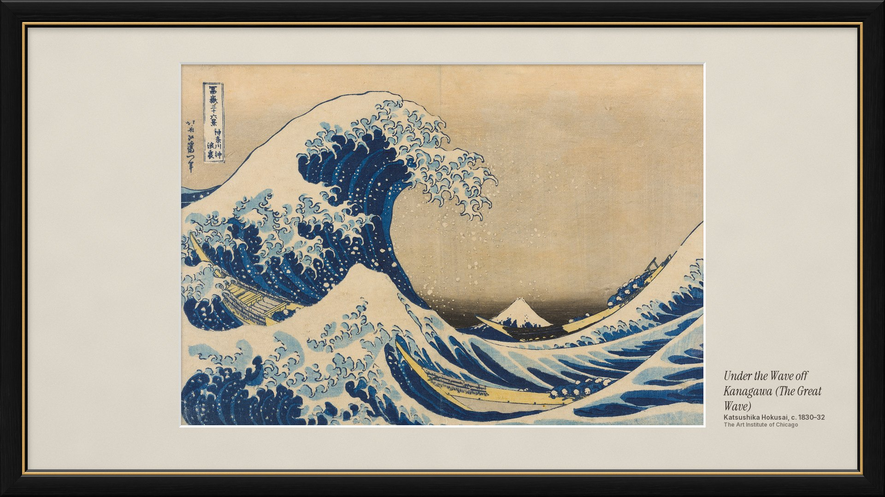
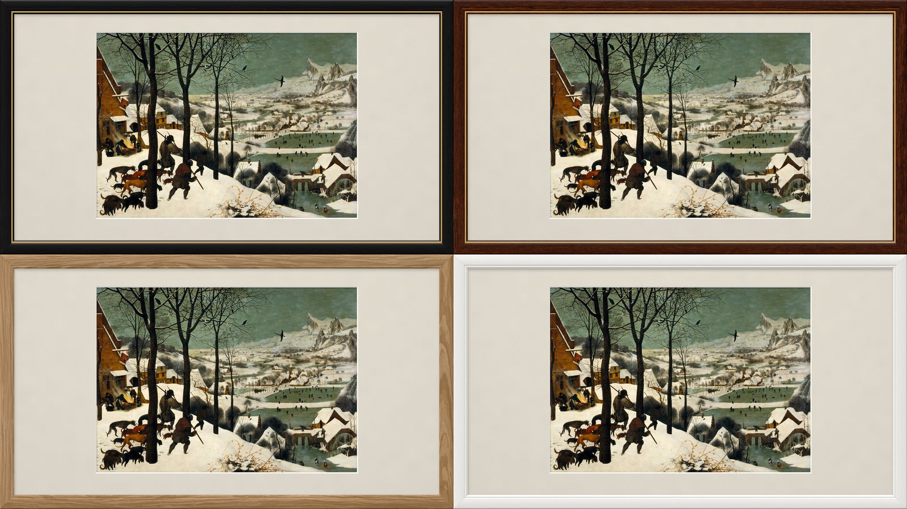
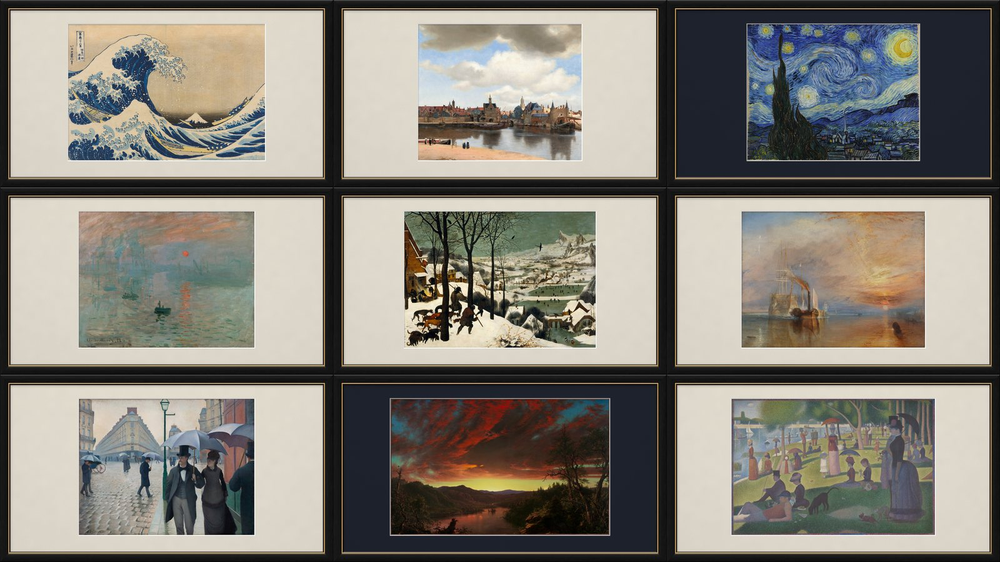

# Rattan

**A quiet home screen for Android TV, and a screensaver that turns the TV into a framed painting.**



## Gallery: the TV as a picture frame

When nobody is watching, Rattan's screensaver hangs a painting on the wall: matted, framed and lit
like a museum print, in the spirit of Samsung's The Frame. It comes with **128 public-domain
masterpieces** by 59 painters, from Vermeer, Bruegel and Rembrandt to Turner, Hokusai, Monet and
Van Gogh, taken from the museums' own high-resolution scans: the National Gallery of Art in
Washington, the Art Institute of Chicago, the Met, the Cleveland Museum of Art, the National
Gallery in London, the Musée d'Orsay and others. Every work is landscape-format, so it fills a TV.

What makes it look like a real frame and not a slideshow:

- **A moulding with depth.** Real wood grain, a mitred corner, a profile shaded by a picture light
  from the top left, and a thin gilded slip on the inside edge.
- **A mat cut for each painting.** Warm white for most, charcoal, navy, umber or green for night
  scenes and dark interiors, chosen from the painting's own tones. It has paper grain, a bevelled
  window, and the soft shadow the frame casts onto it.
- **The painting shown at its best.** Each scan is resized once, straight from the museum's file
  (3,000 to 4,000 pixels wide) to its place on screen, and shown pixel for pixel.
- **A wall label.** Title in italic serif, artist, date and museum, set beside the painting or
  under it, like a gallery card. It fades in after the painting and leaves after twenty seconds.
- **Slow, quiet changes.** A new painting every three minutes with a long cross-fade. The same
  artist never comes twice in a row, and the order survives a reboot.
- **Dimmer in the evening.** From 8 pm the picture softens a little, as a painting does under
  room light at night, and it is back to full brightness by 7 am.

Four frames, one setting: black with a gilded slip (the default), walnut, natural oak and white.





**Art Mode.** The frame button on the home screen opens the same gallery whenever you like: left
and right step through the paintings, OK shows or hides the label, Back returns home.

**Light on the TV.** All the framing is done ahead of time on a computer (`tools/art/render.py`),
so the TV only decodes one JPEG at a time, straight into GPU memory, and cross-fades. Between
fades nothing is redrawn. The next painting is decoded 15 seconds before it is due, so every fade
starts on time. Gallery added about 1 MB to Rattan's memory on the TV. The app has no `INTERNET`
permission; the paintings are copied to the TV once.

The full list of paintings, with every museum and image source, is in
[docs/paintings.md](docs/paintings.md).

## The home screen


- A still photo as the background, with smoked glass for the inputs, the Art Mode and settings
  buttons and the app dock. One OpenGL shader draws photo and glass: the rim bends the photo, the
  inside is darkened and lightly frosted, the edge catches the light, and a soft oval quiets the
  photo behind the clock. It redraws only when the layout changes, never on focus.
- Type: a large Instrument Serif clock with a letter-spaced gold date, and the focused item's name
  in italic serif above the dock.
- Focus is one glass lens that springs from item to item, reshaping as it goes: a ring with a
  gold glow around app banners, a clear pane over controls. Nothing pulses.
- Every app fits in the dock (balanced rows of at most seven); focus always starts on the first app.
- HDMI inputs and Live TV as buttons of their own.
- Remote buttons (an accessibility service that sees key presses only): Netflix and YouTube open
  their apps, TV opens Live TV, and the clean-up button goes home and closes background apps. Apps
  that are playing (Spotify with music on) keep running.

### Results on the TV

Measured on a TCL 65P7K (1.8 GB RAM) on 2026-10-29, with the Google TV home screen before and
Rattan after, both after a reboot:

| | Google TV home | Rattan |
| --- | --- | --- |
| Free memory | 398 MB | 809 MB |
| Free swap (of 650 MB) | 163 MB | 404 MB |
| Home screen memory | 97 MB | 25 MB |
| Back to Home from Netflix | — | 0.22 s |
| Cold start | — | 0.5–0.6 s |

## Install

Rattan needs Android 12 (API 31) or newer. It is built and tested on a TCL 65P7K with Google TV 12;
Gallery uses only standard Android screensaver APIs. You need `adb` on a computer and network
debugging turned on in the TV's developer options.

### Just the screensaver

This keeps your home screen as it is. Download `rattan.apk` and `rattan-paintings.zip` from the
[latest release](https://github.com/KunalGehlot/rattan-launcher/releases/latest), then:

```sh
adb connect <tv-ip>:5555
adb install rattan.apk
adb shell settings get secure screensaver_components    # note it, to switch back later
adb shell settings put secure screensaver_components site.gehlot.rattan/.ArtDream
adb shell service call dreams 1                         # starts Gallery once, which creates its folder
unzip rattan-paintings.zip -d paintings
adb push --sync paintings/* /sdcard/Android/data/site.gehlot.rattan/files/art/   # about 75 MB
```

Press any key to leave the empty first start. From then on Gallery starts whenever the TV's
screensaver would. If the TV asks which home screen to use, keep your current one. To switch back,
put the noted value back with the same `settings put` line.

### The home screen too

```sh
tools/install.sh <tv-ip>:5555
```

It builds, installs, compiles ahead of time, grants TCL's `APP_AUTO_START` (without it TCL's
TclAppBoot refuses to start the remote-button service), re-binds that service (an install unbinds
it and the system leaves it so) and makes Rattan the home screen.

Back to the Google TV home screen (if you disabled it):

```sh
adb shell pm enable com.google.android.apps.tv.launcherx
adb shell pm enable com.google.android.tungsten.setupwraith
adb shell cmd package set-home-activity com.google.android.apps.tv.launcherx/.home.HomeActivity
```

### Made for one TV

A few things are set for the TV and home network it was built for. Change them for yours:

- The remote buttons use TCL's key codes (`RemoteKeys.kt`).
- HDMI inputs open through TCL's live-TV app (`Inputs.kt`).
- Live TV plays a FRITZ!Box's cable channel list in VLC; the playlist address is `PLAYLIST` in
  `Inputs.kt`. The button only appears when VLC is installed.
- The apps shown first, and the system apps hidden, are lists in `res/values/strings.xml`.
- `tools/install.sh` and `tools/art/push.sh` default to the TV at `192.168.178.59:5555`; pass
  yours as the argument.

## Your own gallery

The paintings are chosen in `tools/art/picks.json`; each pick names its image source, and can set
its mat and trim scan borders. To build the set from the museums' files yourself (Python 3 with
numpy, Pillow and SciPy):

```sh
python3 -I tools/art/fetch.py    # downloads the works in picks.json to art/masters (about 400 MB)
python3 -I tools/art/render.py   # frames them into art/out (1920x1080 JPEGs) with catalog.json
tools/art/push.sh <tv-ip>:5555   # copies them to the TV, only what changed
python3 -I tools/art/credits.py  # rewrites docs/paintings.md from picks.json
```

`render.py --frame walnut|black|oak|white` picks the moulding (black is the default), `--only id,…`
renders a few, `--sheet` writes contact sheets. A pick's `mat` sets its mat board (otherwise one is
chosen from the painting's tones) and `trim` crops scan borders. `art/` stays out of git.

## Build

Requirements: JDK 17 and the Android SDK (platform 36, build-tools 36).

```sh
export JAVA_HOME=/opt/homebrew/opt/openjdk@17/libexec/openjdk.jdk/Contents/Home
./gradlew assembleRelease
```

Release builds are signed with `signing/release.jks`, as configured in `signing/keystore.properties`.
Both files stay out of git; without them the release APK is unsigned.

`tools/make_wallpaper.py <photo>` turns a photo into the background (1920x1080, the TV's UI size),
its frosted copy, the banner and the icon.

## Credits

The paintings are in the public domain: open-access images (CC0) from the National Gallery of Art,
the Art Institute of Chicago and the Cleveland Museum of Art, and the museums' own photographs on
Wikimedia Commons. [docs/paintings.md](docs/paintings.md) lists every one with its museum and the
source of the image. The frame's wood grain is Poly Haven's "Wood Table 001" and "Oak Veneer 01"
textures (CC0).

The background photo is by Adrien Olichon on Unsplash
(https://unsplash.com/photos/a-black-and-white-photo-of-a-wall-with-vertical-lines-SPUI_LlBivE),
used under the Unsplash License; the home screen credits it under the dock.

Fonts: Instrument Serif (The Instrument Serif Project Authors) and Inter (The Inter Project
Authors), both SIL Open Font License 1.1; the licence texts are in `licenses/`.

The settings glyph is the Material Icons "settings" icon, Apache License 2.0; the Art Mode glyph
is drawn for Rattan.

## Licence

The code is MIT-licensed (see [LICENSE](LICENSE)). The fonts, the background photo and the
textures keep their own licences, listed above.
